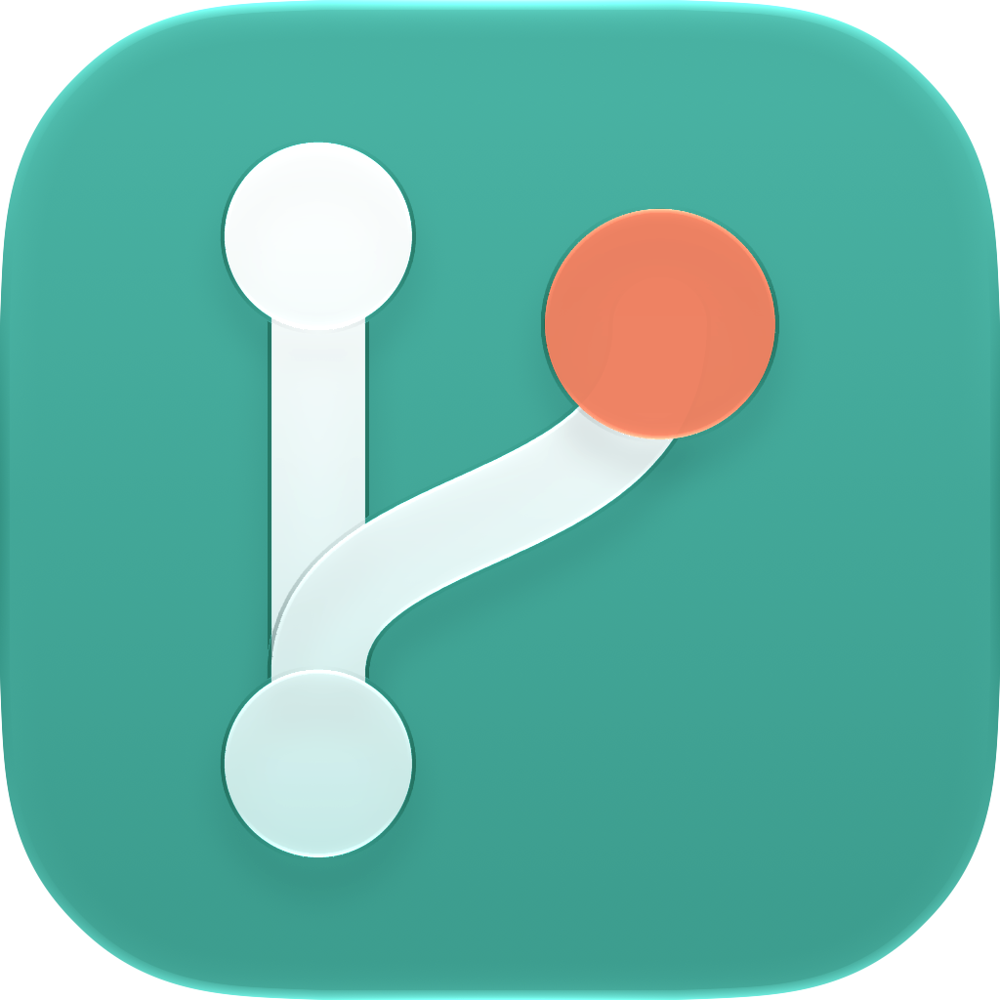
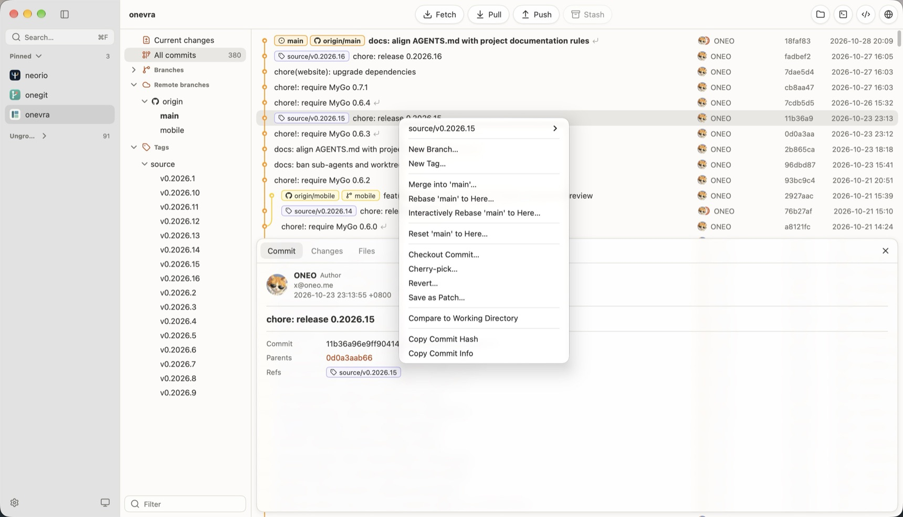

<p align="center">
  
</p>

<h1 align="center">Onegit</h1>

<p align="center">
  <strong>English</strong> |
  <a href="README.zh-CN.md">简体中文</a>
</p>

<p align="center">
  <a href="https://github.com/oneo-me"></a>
  <a href="https://oneo.me"></a>
  <a href="https://x.com/oneo666"></a>
  <a href="https://github.com/sponsors/oneo-me"></a>
</p>

<p align="center">
  Onegit is a worktree-centered macOS app that gathers many Git repositories in one window. It covers everyday repository browsing and worktree switching, not every feature of a general Git client.
</p>

<p align="center">
  
</p>

## Features

- Scan a parent directory into a sidebar tree; pin or group projects, give them an icon, and find them with the command palette (`⌘F`).
- Switch worktrees above the branches, and open the shown one in the file manager, a terminal or a development tool, or its repository on GitHub.
- Review staged and unstaged changes, stage files or lines, discard changes, stash files, and commit with a per-worktree draft.
- Browse the commit graph, search history and the reflog, compare commits, and open a file's history or blame.
- Manage branches, tags, remotes and stashes, and rebase, merge, cherry-pick or revert with conflict handling.
- Push a repository without remotes to a new GitHub repository through the GitHub CLI.
- Every Git write runs only when you click, except remotes set to fetch automatically when a worktree opens.

## Run

Onegit is not released yet. Build it from source as described in [Development](#development). Git must be on `PATH` at runtime.

## Getting started

1. Open Settings with `⌘,` and choose the parent directory that holds your projects.
2. Wait for the background scan to add repositories to the sidebar.
3. Select a project; with several worktrees, double-click one under Worktrees to show it.
4. Choose Current changes or All commits in the project sidebar.

## Development

Requirements: macOS, Go 1.27.3 or later, and Xcode. The [NSGo](https://github.com/nsgo-dev/nsgo) CLI is a Go tool dependency in [go.mod](go.mod), so no global install is needed.

Run from the repository root:

```sh
GOWORK=off go mod download
GOWORK=off go tool nsgo dev
```

`go tool nsgo dev` runs Onegit and reloads it after code changes.

Format, check, test and build:

```sh
gofmt -l .
GOWORK=off go tool nsgo check
GOWORK=off go tool nsgo test
GOWORK=off go test -race ./...
GOWORK=off go tool nsgo build
```

Tests are headless and never open windows or native dialogs. The directory, icon and save pickers, the look of each screen, packaging and the app icon need manual review.

`go tool nsgo build` makes every target [nsgo.yaml](nsgo.yaml) lists: macOS for Apple silicon and Intel, Windows and Linux for x64 and Arm64. Installers land in `dist/releases`: disk images, Windows installers, Debian and Arch packages and AppImages. Windows installers need NSIS (`brew install makensis`).

Read [ARCHITECTURE.md](ARCHITECTURE.md) before changing code, and [AGENTS.md](AGENTS.md) for working rules. User-visible changes are listed in [CHANGELOG.md](CHANGELOG.md).

## License

[MIT](LICENSE) © 2026 ONEO.
