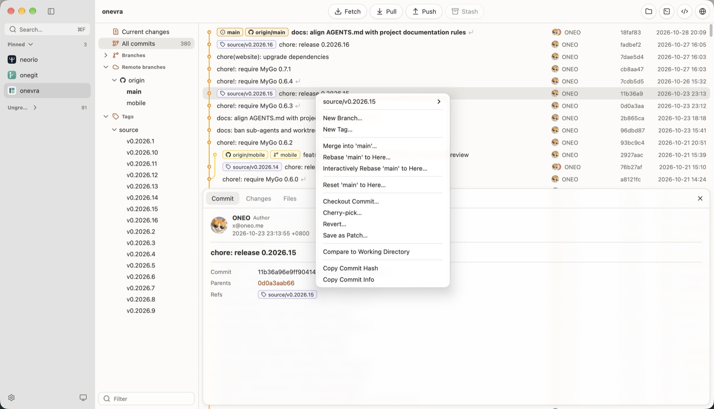

# Onegit

[English](README.md) | **简体中文**

Onegit 是以 worktree 为中心的 macOS 应用，在一个窗口中汇集多个 Git 仓库。它承接日常的仓库浏览与 worktree 切换，不追求覆盖通用 Git 客户端的全部功能。



## 功能

- 扫描项目父目录中的 Git 仓库，并在侧边栏以目录树浏览。
- 将项目置顶到目录树上方，或放入自建分组，并拖拽调整分组顺序。
- 从项目菜单打开项目文件夹、选择图片作为项目图标，或将其从侧边栏移除，并可撤销或恢复。
- 通过命令面板（`⌘F`）查找项目与设置。
- 在分支上方双击项目的 worktree 即可切换；从标题栏在文件管理器、终端或设置中选择的开发工具中打开当前 worktree，或在 GitHub 上打开仓库。
- 分别查看已暂存与未暂存的改动，按文件、改动块或所选行暂存，放弃改动块或所选行，贮藏所选文件或复制其路径，并填写信息提交。
- 修改上一次提交，一次完成提交与推送，并为每个 worktree 保留提交信息草稿。
- 浏览可折叠合并的完整提交图谱、历史查找，以及含差异与文件内容的提交详情。
- 固定引用、从 reflog 查看丢失的提交、按信息/作者/更改路径或内容搜索历史、比较提交或提交与工作区，并查看文件历史或追溯。
- 从文件菜单打开或在文件管理器中显示文件、打开文件夹、保存所显示的版本，或将文件重置为提交或其父提交的版本。
- 浏览本地分支、远程分支与标签，从分组菜单新建分支或标签，删除过期的本地分支，并跳转到对应提交。
- 双击引用或提交即可检出，也可从菜单检出到当前或新的 worktree、拉取、合并、变基、新建分支或标签、删除或复制；分支菜单还可推送、快进、重命名和更改上游。
- 从远程菜单获取、编辑或删除远程，在打开 worktree 时自动获取，在 GitHub 上查看或复制其地址。
- 从变基对话框查看冲突，并可同时更新依赖的分支或暂存本地改动；也可交互式改写、压缩、修正或丢弃提交。
- 继续或中止停下的合并、变基、拣选或还原，选择任一侧解决冲突并暂存文件。
- 从菜单重置、拣选、还原提交或保存为补丁，也可应用、重命名或删除贮藏。
- 选择合并类型（包括压缩和不提交），并一次删除或推送多个分支或标签。
- 获取、拉取、推送、贮藏和菜单操作等 Git 写入仅在点击时执行；设为自动获取的远程会在打开 worktree 时获取。

## 运行

Onegit 尚未发布，请按[开发](#开发)从源码构建。运行时需能从 `PATH` 找到 Git。

## 快速开始

1. 按 `⌘,` 打开设置，选择存放项目的父目录。
2. 等待后台扫描把仓库加入侧边栏。
3. 选择项目；有多个 worktree 时，在“工作树”下双击要查看的那个。
4. 在项目侧边栏中选择“当前更改”或“全部提交”。

## 开发

需要 macOS、Go 1.27.3 或更新版本及 Xcode Command Line Tools。MyGo CLI 是 [go.mod](source_mygo/go.mod) 中声明的 Go 工具依赖，无需全局安装。

在 `source_mygo/` 下运行：

```sh
cd source_mygo
GOWORK=off go mod download
go tool mygo dev
```

`go tool mygo dev` 运行 `Onegit Dev`，代码修改后自动重启。

在 `source_mygo/` 下格式检查、测试、检查与构建：

```sh
gofmt -l .
GOWORK=off go test ./...
GOWORK=off go test -race ./...
GOWORK=off go tool mygo vet
GOWORK=off go tool mygo build
```

测试均为无界面运行，不会打开窗口或原生对话框。目录与图标选择器、打包与应用图标需人工检查。产物写入 `dist/<os>-<arch>/`，使用临时签名且未经公证。

在 `source_mygo/` 下构建全平台发布包：macOS 通用应用与磁盘映像、Windows 安装程序，以及 Linux 归档与 Debian 包。Windows 安装程序需要 NSIS（`brew install makensis`）。

```sh
GOWORK=off go tool mygo build -platform darwin/universal,windows/amd64,windows/arm64,linux/amd64,linux/arm64
```

Neorio 用户可从 [.neorio/config.yaml](.neorio/config.yaml) 获得相同的 Run、Build、Test 与 Vet 任务，其中 Build 构建上述发布包。

修改代码前先阅读 [ARCHITECTURE.md](ARCHITECTURE.md)，协作规则见 [AGENTS.md](AGENTS.md)。用户可感知的变化记录在 [CHANGELOG.md](CHANGELOG.md)。

## 作者

[博客](https://oneo.me) · [X @oneo666](https://x.com/oneo666)

## 许可证

[MIT](LICENSE) © 2026 ONEO。
