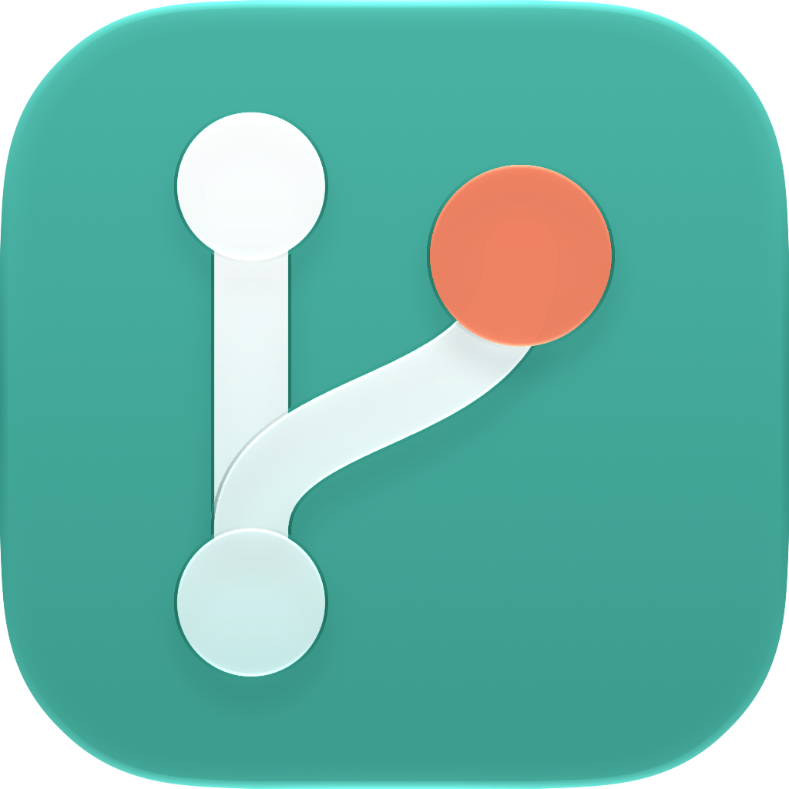
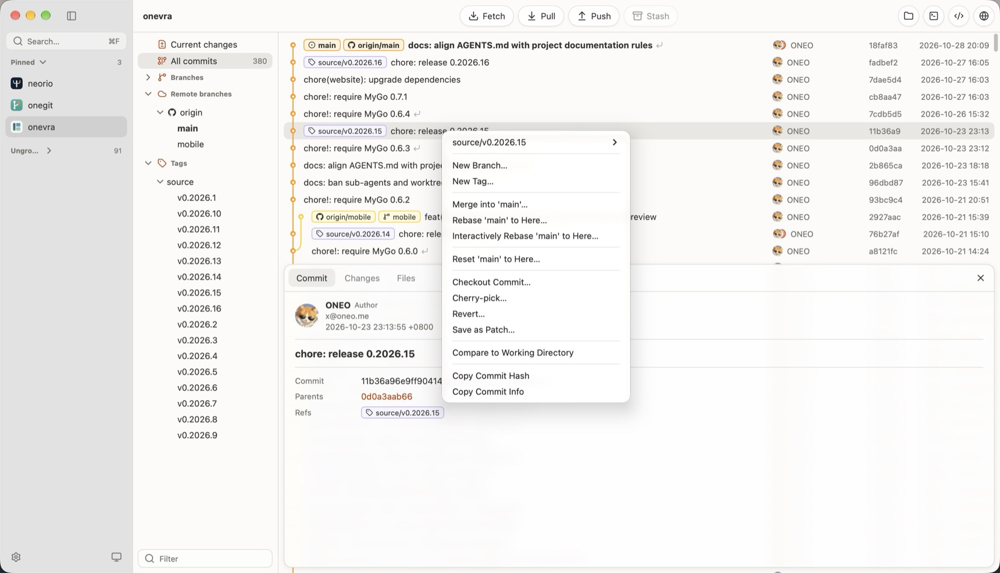

<p align="center">
  
</p>

<h1 align="center">Onegit</h1>

<p align="center">
  <strong>简体中文</strong> |
  <a href="README.md">English</a>
</p>

<p align="center">
  <a href="https://github.com/oneo-me"></a>
  <a href="https://oneo.me"></a>
  <a href="https://x.com/oneo666"></a>
  <a href="https://github.com/sponsors/oneo-me"></a>
</p>

<p align="center">
  <a href="https://awesomemygo.dev/apps/onegit"></a>
</p>

<p align="center">
  Onegit 是以 worktree 为中心的 macOS 应用，在一个窗口中汇集多个 Git 仓库。它承接日常的仓库浏览与 worktree 切换，不追求覆盖通用 Git 客户端的全部功能。
</p>

<p align="center">
  
</p>

## 功能

- 扫描项目父目录并在侧边栏以目录树浏览，可置顶、分组、设置图标，并通过命令面板（`⌘F`）查找。
- 在分支上方切换 worktree，并在文件管理器、终端或开发工具中打开当前 worktree，或在 GitHub 上打开仓库。
- 查看已暂存与未暂存的改动，按文件或所选行暂存，放弃改动，贮藏文件，并填写每个 worktree 独立的提交信息草稿。
- 浏览提交图谱，搜索历史与 reflog，比较提交，并查看文件历史或追溯。
- 管理分支、标签、远程与贮藏，并进行变基、合并、拣选或还原，处理其中的冲突。
- 将没有远程的仓库通过 GitHub CLI 推送到新的 GitHub 仓库。
- 获取、拉取、推送、贮藏等 Git 写入仅在点击时执行；设为自动获取的远程会在打开 worktree 时获取。

## 运行

Onegit 尚未发布，请按[开发](#开发)从源码构建。运行时需能从 `PATH` 找到 Git。

## 快速开始

1. 按 `⌘,` 打开设置，选择存放项目的父目录。
2. 等待后台扫描把仓库加入侧边栏。
3. 选择项目；有多个 worktree 时，在“工作树”下双击要查看的那个。
4. 在项目侧边栏中选择“当前更改”或“全部提交”。

## 开发

需要 macOS、Go 1.27.3 或更新版本及 Xcode Command Line Tools。MyGo CLI 是 [go.mod](source_mygo/go.mod) 中声明的 Go 工具依赖，无需全局安装。

在 `source_mygo/` 下运行：

```sh
cd source_mygo
GOWORK=off go mod download
go tool mygo dev
```

`go tool mygo dev` 运行 `Onegit Dev`，代码修改后自动重启。

在 `source_mygo/` 下格式检查、测试、检查与构建：

```sh
gofmt -l .
GOWORK=off go test ./...
GOWORK=off go test -race ./...
GOWORK=off go tool mygo vet
GOWORK=off go tool mygo build
```

测试均为无界面运行，不会打开窗口或原生对话框。目录与图标选择器、打包与应用图标需人工检查。产物写入 `dist/<os>-<arch>/`，使用临时签名且未经公证。

在 `source_mygo/` 下构建全平台发布包：macOS 通用应用与磁盘映像、Windows 安装程序，以及 Linux 归档与 Debian 包。Windows 安装程序需要 NSIS（`brew install makensis`）。

```sh
GOWORK=off go tool mygo build -platform darwin/universal,windows/amd64,windows/arm64,linux/amd64,linux/arm64
```

Neorio 用户可从 [.neorio/config.yaml](.neorio/config.yaml) 获得相同的 Run、Build、Test 与 Vet 任务，其中 Build 构建上述发布包。

修改代码前先阅读 [ARCHITECTURE.md](ARCHITECTURE.md)，协作规则见 [AGENTS.md](AGENTS.md)。用户可感知的变化记录在 [CHANGELOG.md](CHANGELOG.md)。

## 许可证

采用 [MIT](LICENSE) 协议 © 2026 ONEO。
